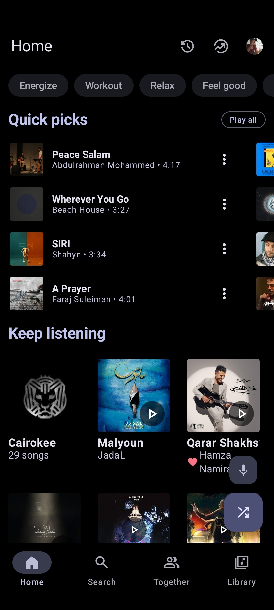
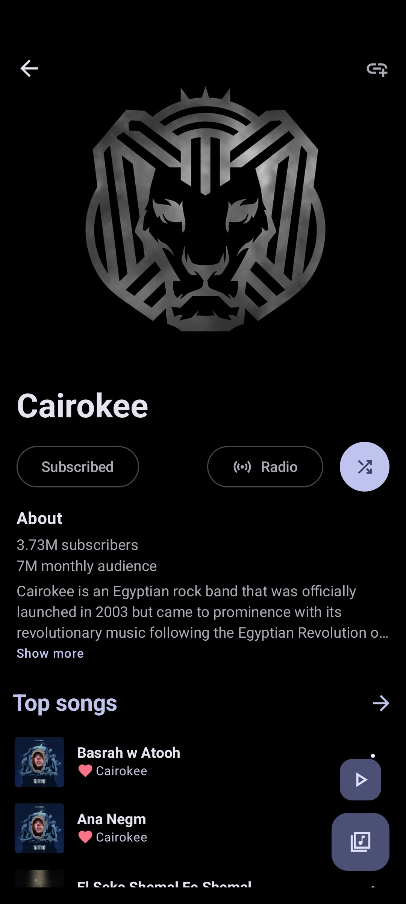
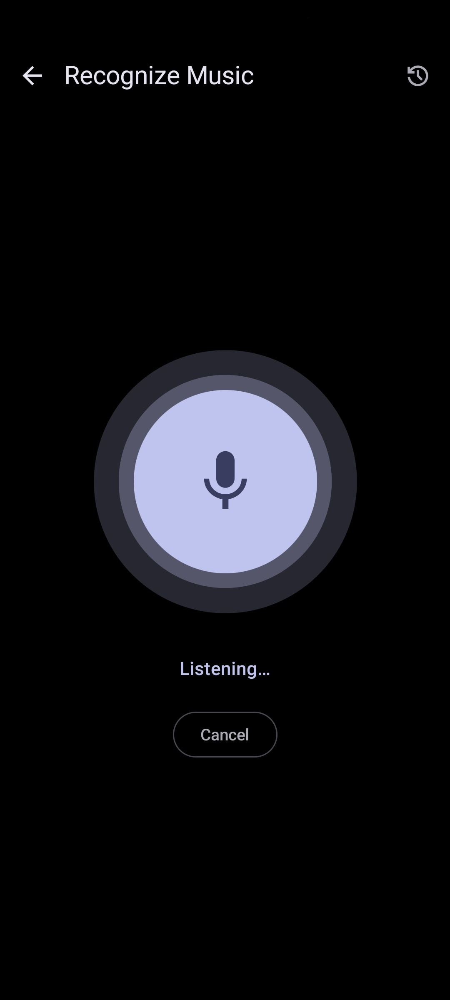
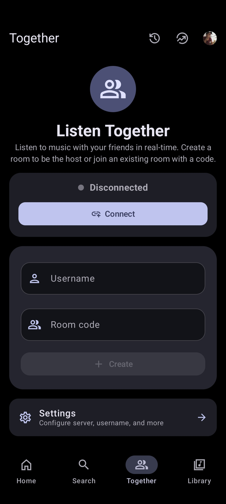
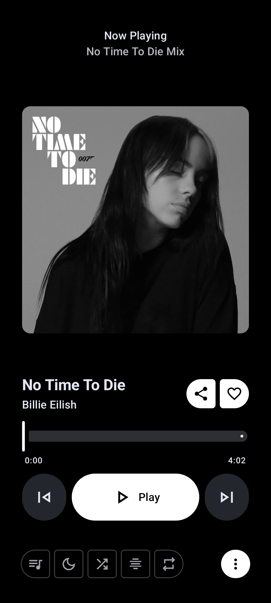
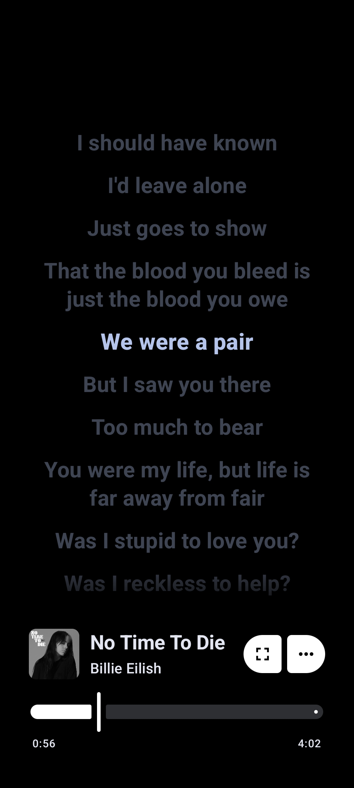

<div align="center">

<picture>
  <source media="(prefers-color-scheme: dark)" srcset="assets/logo-animated-dark.svg" />
  
</picture>

# TMUSIC

### A modern, open-source YouTube Music client for Android

[](https://tmusic-web.vercel.app/)
[](https://tmusic-web.vercel.app/)
[](https://github.com/mdanseergit/Tmusic/releases)

<br />

[](LICENSE)
[](https://www.android.com)
[](https://kotlinlang.org)
[](https://m3.material.io)
[](https://github.com/mdanseergit/Tmusic/stargazers)
[](https://github.com/mdanseergit/Tmusic/forks)
[](https://github.com/mdanseergit/Tmusic/releases/latest)
[](https://github.com/mdanseergit/Tmusic/issues)

<br />

[Features](#features) · [Screenshots](#screenshots) · [Download](#download-install) · [Build](#build-from-source) · [Guide](#using-tmusic) · [FAQ](#faq) · [Credits](#credits)

</div>

---

## What is TMUSIC?

TMUSIC is a third-party Android client for YouTube Music. It streams songs, albums, artists, videos, and playlists through YouTube Music's API, with a clean monochrome interface and focused playback controls.

- Minimal monochrome UI built with Jetpack Compose and Material 3
- Background playback, offline downloads, and deep audio controls
- Live synced lyrics, playlist import, and music discovery
- Home-screen widgets, Last.fm scrobbling, and optional account sync

This project is a fork of [Metrolist](https://github.com/MetrolistGroup/Metrolist).

> [!WARNING]
> **Regional restriction** — If YouTube Music is unavailable in your region, TMUSIC will not work without a VPN or proxy connected to a supported region.

> [!NOTE]
> TMUSIC is not affiliated with, funded, authorized, endorsed by, or in any way associated with YouTube, Google LLC, Metrolist Group LLC, or any of their affiliates and subsidiaries. All trademarks and service marks belong to their respective owners.

---

## Features

| Group | Capabilities |
| --- | --- |
| **Playback** | Stream songs, albums, artists, videos, and playlists; background playback; offline cache; queue reordering; skip silence; sleep timer |
| **Audio** | Equalizer, bass boost, tempo and pitch control, audio normalization, crossfade |
| **Lyrics & Discovery** | Time-synced lyrics, search across songs / albums / artists / videos / playlists, personalized quick picks, music recognition |
| **Library & Account** | Local library management, playlist import, YouTube Music login, sync of songs / artists / albums / playlists |
| **Social** | Listen together rooms, Last.fm scrobbling, Discord Rich Presence |
| **Interface** | Light / Dark / Black / Dynamic themes, monochrome accents, Inter typeface, home-screen widgets, Material 3 motion |

---

## Screenshots

<div align="center">









</div>

---

<a id="download-install"></a>

## Download & Install

TMUSIC requires **Android 8.0+** (`minSdk 26`).

1. Click **[Download APK](https://tmusic-web.vercel.app/)**.
2. Allow **Install unknown apps** for the browser you used.
3. Open the downloaded APK and tap **Install**.
4. Launch **TMUSIC** from your app drawer.

You can also install a locally built APK with `adb install app/build/outputs/apk/foss/debug/app-foss-debug.apk`.

---

<a id="build-from-source"></a>

## Build from source

### Prerequisites

| Requirement | Version / notes |
| --- | --- |
| **JDK** | 21 (Temurin or equivalent). The project uses the Java 21 toolchain and core-library desugaring. |
| **Android SDK** | Platform 37 (`compileSdk`), `targetSdk` 36, `minSdk` 26. Android Studio can install these. |
| **Build Tools** | 35.0.0 used by CI; newer versions also work. |
| **Gradle** | 9.7.0, downloaded automatically by the included wrapper. |

### 1. Get the source

```bash
git clone https://github.com/mdanseergit/Tmusic.git
cd Tmusic
```

### 2. Point Gradle at your Android SDK

Create `local.properties` in the project root. It is ignored by git and local to your machine:

```properties
sdk.dir=<path-to-android-sdk>
LASTFM_API_KEY=<your_lastfm_api_key>
LASTFM_SECRET=<your_lastfm_secret>
```

### 3. Build with Android Studio

1. Open **Android Studio** and choose **Open** → select the project root.
2. Let Gradle sync finish. Configure JDK 21 in **Settings → Build Tools → Gradle** if needed.
3. Pick a variant in **Build Variants**, for example `fossDebug`.
4. Press **Run** to install on a connected device or emulator.

### 4. Build from the command line

```bash
# Windows
gradlew.bat :app:assembleFossDebug

# macOS / Linux
./gradlew :app:assembleFossDebug
```

### Build variants

| Flavor | Description | Notes |
| --- | --- | --- |
| `foss` (default) | In-app updater, no Google Cast | Recommended daily driver |
| `gms` | In-app updater and Google Cast | Requires Google Play services |
| `izzy` | No updater, no Cast | F-Droid-compliant build |

```bash
./gradlew :app:assembleFossDebug       # FOSS debug
./gradlew :app:assembleFossRelease     # FOSS release
./gradlew :app:assembleGmsDebug        # GMS debug
./gradlew :app:assembleIzzyRelease     # Izzy release
./gradlew lintGmsRelease               # Run lint manually
```

Outputs land in `app/build/outputs/apk/<flavor>/<buildType>/`.

### Optional configuration

| Variable | Purpose |
| --- | --- |
| `METROLIST_APPLICATION_ID` | Override the application ID (default `com.metrolist.music`). |
| `METROLIST_APP_NAME` | Override the launcher app name (default `TMUSIC`). |
| `METROLIST_BUILD_COMMIT` | 7–40 character git SHA appended to the version name. |
| `METROLIST_DEBUG_KEYSTORE_PATH` / `METROLIST_DEBUG_KEYSTORE_PASSWORD` / `METROLIST_DEBUG_KEY_ALIAS` / `METROLIST_DEBUG_KEY_PASSWORD` | Custom debug signing config. Defaults: `androiddebugkey` / `android`. |
| `LASTFM_API_KEY` / `LASTFM_SECRET` | Enable Last.fm scrobbling. Get keys at https://www.last.fm/api. |
| `STORE_PASSWORD` / `KEY_ALIAS` / `KEY_PASSWORD` | Release signing credentials. |

### Signing a release build

- **Debug builds** need no configuration. A debug keystore is used automatically (`app/persistent-debug.keystore` if present, otherwise `~/.android/debug.keystore`).
- **Release builds** use `app/keystore/release.keystore` with the passwords in the environment. If no release keystore is present, the build falls back to the debug signing config.

```bash
set STORE_PASSWORD=<your_store_password>   # Windows
set KEY_ALIAS=<your_alias>
set KEY_PASSWORD=<your_key_password>
./gradlew :app:assembleFossRelease
```

Generate your own keystore if you do not have one:

```bash
keytool -genkey -v -keystore release.keystore \
        -alias <your_alias> -keyalg RSA -keysize 2048 -validity 10000
```

> [!IMPORTANT]
> Never commit your keystore or passwords. Keystores, passwords, and API keys are not tracked by git.

### A note on YouTube Music access

TMUSIC talks to YouTube Music through the `innertube` API, the `innertubex` library, and `zemer-cipher` for cipher de-obfuscation and PoToken generation. No personal API key is required. If you fork this project, keep those dependencies up to date because upstream endpoints and ciphers can change.

The inherited Metrolist Actions workflows are disabled in this repository. Build locally with the commands above.

---

<a id="using-tmusic"></a>

## Using TMUSIC

### First launch

1. Install the APK and open **TMUSIC**.
2. You can log in with your YouTube Music account under **Settings → Account** to sync your library, likes, and playlists, or use the app anonymously.

### Playback

- Tap any song, album, artist, or video to start playback.
- The **mini player** shows the current track; swipe it up for the full player with seek bar, lyrics, and queue.
- On the player you can enable repeat and shuffle, adjust the equalizer / bass boost, change tempo and pitch, and toggle skip silence.
- Use the **sleep timer** under **Settings → Player** to stop playback automatically.

### Downloads & offline

- Long-press a song, album, or playlist → **Download** to cache it offline.
- Manage offline content under **Library → Downloads**.
- Change the storage path under **Settings → Storage**.

### Playlists

- Create local playlists from anywhere in the app.
- Import playlists under **Settings → Playlist import** and reorder songs by dragging in the playlist or queue.
- Logging in lets you sync and manage YouTube Music playlists.

### Search & discovery

- Search songs, albums, artists, videos, and playlists from the search tab.
- The home feed shows quick picks, trending, and personalized recommendations when logged in.

### Lyrics

- Open the player and swipe to the **lyrics** tab for time-synced lyrics.
- Configure translation and lyrics providers in **Settings → Lyrics**.

### Extras

- **Recognize music** — identify a song playing around you.
- **Listen together** — create or join a real-time room.
- **Last.fm** — enable scrobbling in **Settings → Account** when keys were configured at build time.
- **Widgets** — add the home-screen player widget for quick controls.
- **Themes** — Light, Dark, Black, and dynamic color modes in **Settings → Appearance**.

---

<a id="faq"></a>

## FAQ

**Why can't I search or play anything?**
YouTube Music may be region-locked where you are. Connect through a VPN or proxy to a supported region. Search and playback can also fail after upstream cipher changes; update the app or the `innertubex` / `zemer-cipher` dependencies.

**Is my account required?**
No. You can browse and play without logging in. Logging in syncs your library and playlists.

**Is this official YouTube/Google software?**
No. TMUSIC is an independent open-source client. See the disclaimer below.

**Where do I get the APK?**
Use the [Download APK button](https://tmusic-web.vercel.app/) or the [Releases page](https://github.com/mdanseergit/Tmusic/releases).

---

## What's new

Latest release: **v13.6.4**

### Added
- Baseline profiles and a benchmark build variant for repeatable on-device performance measurement.
- Room index on `Event.timestamp` with automatic migration to schema 39.

### Changed
- Lazy startup prewarm for Listen Together and player configuration.
- Instant home cache and stable list keys/content types to reduce home-screen layout pop-in.
- Widget refresh throttled to 1 Hz and skipped when no widgets are placed.
- Lighter player surfaces with reduced GPU blur and shadow elevation.
- Coil crossfade disabled globally; image-loader initialization no longer blocks the caller.

### Fixed
- Player connection child scope is cancelled on dispose to prevent collector leaks.

See [changelog.md](changelog.md) for the full history.

---

## Contributing

Fork the repository, create a branch, make your change, and open a pull request. See [development_guide.md](development_guide.md) for setup details.

---

<a id="credits"></a>

## Credits

TMUSIC is a fork of **Metrolist** and stands on the work of the open-source community.

| Project | Contribution |
| --- | --- |
| [Metrolist](https://github.com/MetrolistGroup/Metrolist) | Upstream project this fork is based on |
| [InnerTune](https://github.com/z-huang/InnerTune) | Original inspiration |
| [OuterTune](https://github.com/DD3Boh/OuterTune) | Inspiration |
| [innertubex](https://github.com/MetrolistGroup/innertubex) | YouTube Music API client |
| [zemer-cipher](https://github.com/ZemerTeam/zemer-cipher) | Cipher de-obfuscation and PoToken |
| [Better Lyrics](https://better-lyrics.boidu.dev) | Time-synced lyrics engine |
| [MusicRecognizer](https://github.com/aleksey-saenko/MusicRecognizer) | Music recognition |

---

## License + disclaimer

TMUSIC is licensed under the **GNU General Public License v3.0**. See [LICENSE](LICENSE).

> [!NOTE]
> TMUSIC is not affiliated with, funded, authorized, endorsed by, or in any way associated with YouTube, Google LLC, Metrolist Group LLC, or any of their affiliates and subsidiaries. All trademarks and service marks belong to their respective owners.

<br />

<div align="center">

**Made with ❤️ by Mohammed Danseer**

</div>
